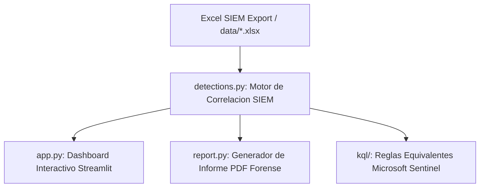
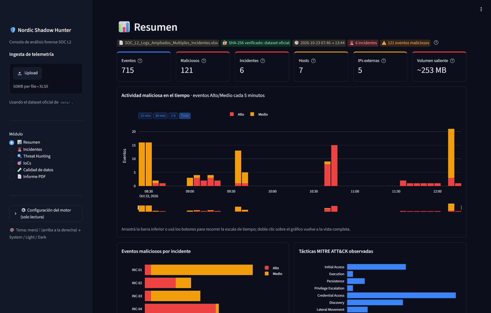
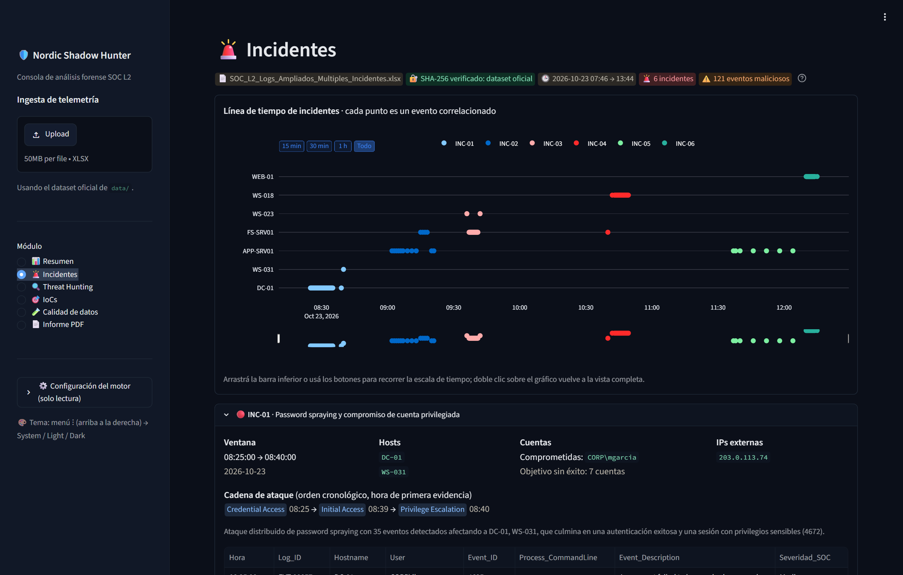
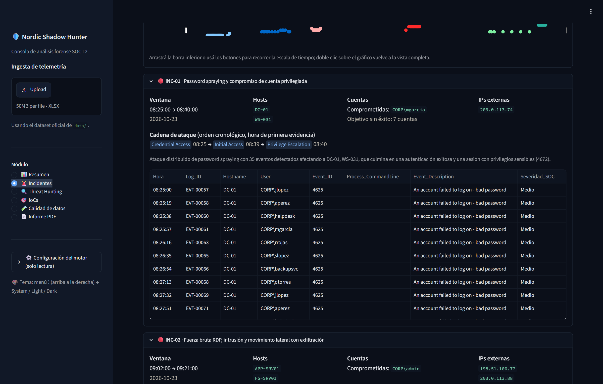
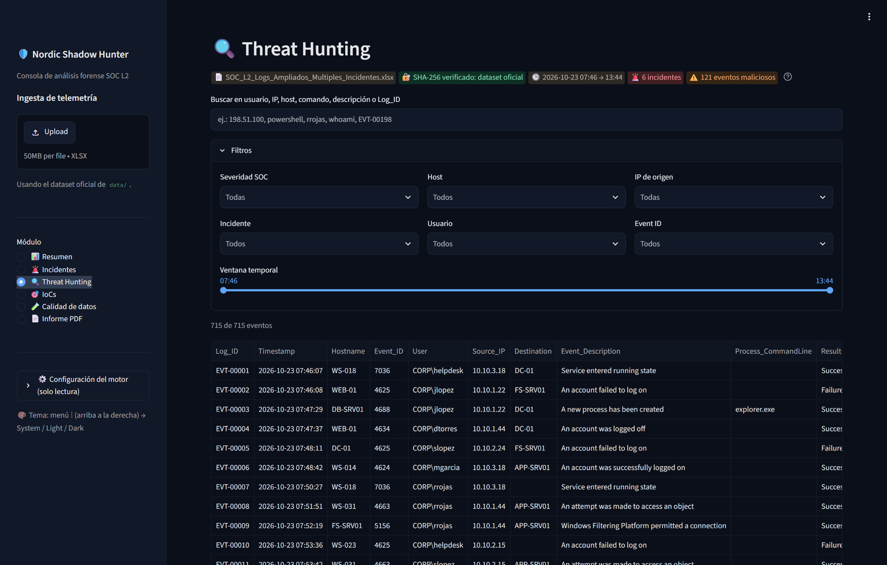
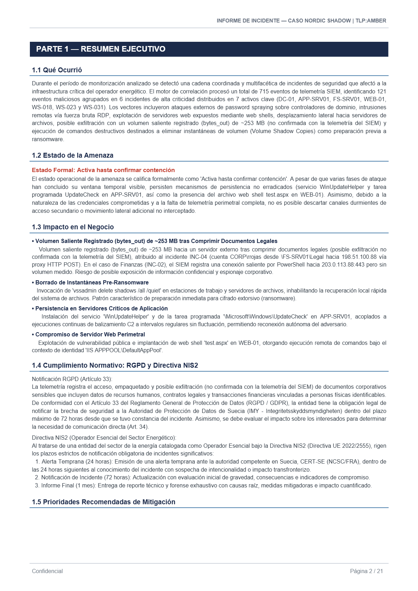

# Nordic Shadow Hunter — Plataforma de Análisis Forense y Detección de Amenazas (SOC L2)


-brightgreen?logo=pytest)


Plataforma integral de análisis forense, ingeniería de detección y visualización de telemetría SIEM diseñada para la investigación de intrusiones complejas y multi-vector en entornos corporativos de infraestructura crítica.

---

## 📋 Tabla de Contenidos

1. [Descripción del Caso Forense: Caso Nordic Shadow](#-descripción-del-caso-forense-caso-nordic-shadow)
2. [Arquitectura del Sistema](#-arquitectura-del-sistema)
3. [Hallazgos Forenses e Incidentes Correlacionados](#-hallazgos-forenses-e-incidentes-correlacionados)
4. [Metodología de Detección: Evidencia Antes que Intuición](#-metodología-de-detección-evidencia-antes-que-intuición)
   - [Falsedad de la Severidad Original del SIEM](#falsedad-de-la-severidad-original-del-siem)
   - [Reglas de Detección (R01 a R14)](#reglas-de-detección-r01-a-r14)
   - [Anomalías de Calidad de Datos y Hallazgos Negativos](#anomalías-de-calidad-de-datos-y-hallazgos-negativos)
   - [Atribución de Amenazas (Metodología ACH)](#atribución-de-amenazas-metodología-ach)
5. [Instalación y Puesta en Marcha (Ubuntu 24.04 LTS)](#-instalación-y-puesta-en-marcha-ubuntu-2404-lts)
6. [Guía de Uso del Dashboard Interactivo](#-guía-de-uso-del-dashboard-interactivo)
7. [Suite de Pruebas Automatizadas y Verificación](#-suite-de-pruebas-automatizadas-y-verificación)
8. [Estructura del Repositorio](#-estructura-del-repositorio)
9. [Limitaciones y Próximos Pasos](#-limitaciones-y-próximos-pasos)
10. [Enlaces de Entrega](#-enlaces-de-entrega)
11. [Créditos y Reconocimientos](#-créditos-y-reconocimientos)

---

## 🔍 Descripción del Caso Forense: Caso Nordic Shadow

El presente proyecto documenta la investigación técnica y forense realizada sobre la infraestructura tecnológica de un **Operador del Sector Energético Nórdico**, clasificado como **Operador Esencial** bajo la **Directiva Europea NIS2** (Directiva UE 2022/2555).

Durante una ventana de observación de aproximadamente 6 horas (**2026-10-23 de 07:46:07 a 13:44:06**), la organización fue blanco de múltiples actividades cibernéticas hostiles concurrentes. El análisis de la telemetría consolidada en exportaciones SIEM (registros de seguridad de Windows Event Logs, proxies web corporativos, servidores IIS y eventos de ejecución de procesos) arrojó las siguientes métricas globales:

| Indicador Clave (KPI) | Valor Verificado | Descripción Operativa |
| :--- | :---: | :--- |
| **Total de Eventos Analizados** | **715** | Registros de telemetría normalizados e ingeridos desde el export SIEM. |
| **Eventos Maliciosos Confirmados** | **121** | Eventos clasificados en severidad SOC **Alto** o **Medio** tras correlación contextual. |
| **Incidentes Correlacionados** | **6** | Cadenas de ataque independientes estructuradas mediante clustering analítico. |
| **Activos / Hosts Comprometidos** | **7** | `DC-01`, `APP-SRV01`, `FS-SRV01`, `WEB-01`, `WS-018`, `WS-023` y `WS-031`. |
| **Direcciones IP Externas (IoCs)** | **5** | 3 IPs de ataque perimetral y 2 IPs de destino de comando y control / posible exfiltración. |
| **Volumen Saliente Registrado (`bytes_out`)** | **~253 MB** | **253.305.558 bytes** registrados en solicitudes HTTP POST salientes (posible exfiltración no confirmada con la telemetría del SIEM). |
| **Resumen SHA-256 de Telemetría** | `f645d768...` | Integridad criptográfica verificada: `f645d76800097c09f3102d7d4f1cb5c1b2bb286d6cd054ab3daabe62c69d85f0`. |
| **Estado Operacional de la Amenaza** | **Activa** | Calificada como *Activa hasta confirmar contención* debido a artefactos durmientes. |

---

## 🏗️ Arquitectura del Sistema

El sistema implementa una arquitectura desacoplada basada en la estricta separación de responsabilidades: ingesta y correlación analítica pura, visualización interactiva para analistas, generación de informes forenses ejecutivos/técnicos en PDF, y reglas de detección nativas para SIEM en la nube.



### Componentes de la Solución

1. **`detections.py` (Motor de Correlación SIEM)**:
   - Módulo independiente sin dependencias de presentación visual o Streamlit.
   - Normalización de esquemas: casteo de `Event_ID` mixtos, parseo temporal estricto con zona horaria, e ingeniería de atributos (`is_external_ip` vía módulo `ipaddress`, extracción de `LogonType` y `bytes_out` mediante regex compilados).
   - Motor de evaluación genérico para 14 reglas analíticas (R01 a R14) con umbrales configurables y ventanas deslizantes.
   - Algoritmo de clustering para asignación determinista de incidentes (`INC-01` a `INC-06`) y extracción exhaustiva de IoCs.
2. **`app.py` (Dashboard Interactivo en Streamlit)**:
   - Panel de control para el analista SOC con interfaz en modo oscuro (`#0E1117` / `#1E293B` con acento `#EF4444`).
   - KPIs en tiempo real, filtros multidimensionales en la barra lateral (severidad, incidentes, hosts, usuarios, tipos de log).
   - Visualizaciones analíticas con Plotly (gráfico donut de severidades, matriz MITRE, línea temporal interactiva con dispersión).
   - Explorador de datos con exportación CSV, tabla estructurada de IoCs y panel de auditoría de calidad de datos.
3. **`report.py` y `report_content.py` (Generador de Informe PDF Forense)**:
   - Compilación de informes PDF de nivel forense utilizando `fpdf2` con soporte tipográfico Unicode (DejaVu Sans).
   - Estructuración rigurosa en dos secciones: **Parte 1 — Resumen Ejecutivo** (impacto de negocio, análisis normativo NIS2/RGPD Art. 33, matriz de prioridades operativas) y **Parte 2 — Resumen Técnico** (cronología forense detallada por Log_ID, matriz MITRE ATT&CK, indicadores de compromiso, análisis de atribución ACH y playbooks de contención).
4. **`kql/` (Reglas Equivalentes para Microsoft Sentinel)**:
   - 13 reglas analíticas escritas en Kusto Query Language (`R01_password_spraying.kql` a `R13_web_shell_probing.kql`) preparadas para despliegue en producción sobre Azure Log Analytics / Microsoft Sentinel.

---

## 🚨 Hallazgos Forenses e Incidentes Correlacionados

El motor de correlación identificó un total de **6 incidentes de seguridad** de severidad crítica/alta, cubriendo 121 eventos maliciosos y afectando a 7 activos institucionales:

| Incidente | Título Operativo | Ventana Temporal | Hosts Afectados | Cuentas Involucradas | Eventos Maliciosos | Técnicas MITRE ATT&CK |
| :---: | :--- | :---: | :--- | :--- | :---: | :--- |
| **INC-01** | **Password Spraying y Compromiso de Cuenta Privilegiada** | 08:25:00 – 08:40:00 | `DC-01`, `WS-031` | `CORP\mgarcia` (comprometida) + 7 cuentas objetivo sin éxito | **35** | **T1110.003**, **T1110.001**, **T1078**, **T1078.003** |
| **INC-02** | **Fuerza Bruta RDP, Intrusión y Movimiento Lateral con Posible Exfiltración (No Confirmada)** | 09:02:00 – 09:21:00 | `APP-SRV01`, `FS-SRV01` | `CORP\admin` | **15** | **T1110.001**, **T1078**, **T1078.003**, **T1021.001**, **T1021.002**, **T1059.001**, **T1069.001**, **T1135**, **T1039**, **T1560.001**, **T1041** |
| **INC-03** | **Actividad Previa a Ransomware y Borrado de Copias Shadow** | 09:36:00 – 09:42:00 | `FS-SRV01`, `WS-023` | `CORP\backupsvc` | **18** | **T1059.001**, **T1083**, **T1490** |
| **INC-04** | **Posible Exfiltración de Documentos vía Proxy (bytes_out, No Confirmada)** | 10:40:00 – 10:49:18 | `FS-SRV01`, `WS-018` | `CORP\rrojas` | **24** | **T1039**, **T1560.001**, **T1048.002** |
| **INC-05** | **Persistencia mediante Tarea Programada y Servicio con Balizamiento C2** | 11:37:00 – 12:04:00 | `APP-SRV01` | `CORP\helpdesk` | **7** | **T1053.005**, **T1543.003**, **T1071.001** |
| **INC-06** | **Compromiso de Servidor Web por Web Shell y Ejecución Remota** | 12:10:00 – 12:15:00 | `WEB-01` | `IIS APPPOOL\DefaultAppPool` | **22** | **T1190**, **T1505.003**, **T1033** |

> La cronología completa de cada incidente (eventos con `Log_ID`, IoCs, matriz MITRE ATT&CK y playbook de contención) está en el informe [`sample_report.pdf`](sample_report.pdf).

---

## 🔬 Metodología de Detección: Evidencia Antes que Intuición

### Falsedad de la Severidad Original del SIEM

Uno de los aportes metodológicos centrales de esta investigación es la aplicación del principio **"Evidencia antes que intuición"**. 

En entornos operacionales reales, los registros SIEM etiquetan los eventos de acuerdo con plantillas estáticas de severidad que no contemplan el contexto del adversario. En este dataset, eventos de altísima criticidad e impacto destructivo llegaron catalogados como **"Informational"** o **"Warning"**:
1. **EVT-00123**: Autenticación exitosa (`Event_ID 4624`) de la cuenta `CORP\mgarcia` desde la IP externa `203.0.113.74` inmediatamente después de un ataque masivo de password spraying -> Clasificado originalmente como *Informational*.
2. **EVT-00428**: Ejecución de la herramienta `7z.exe` para compactar contratos clasificados (`C:\Legal\*.docx`) previa a la posible exfiltración por proxy (`bytes_out`) -> Clasificado originalmente como *Informational*.
3. **EVT-00528, 542, 548, 559, 564**: Ejecución periódica del binario `wuhelper.exe` cada 6 minutos exactos (patrón de beacon; el destino de red no figura en la telemetría) -> Clasificado originalmente como *Informational*.
4. **EVT-00314**: Invocación de `vssadmin delete shadows /all /quiet` para eliminar instantáneas de volumen -> Clasificado originalmente como *Warning*.

**Decisión Analítica:** El motor `detections.py` **ignora la severidad provista por la fuente** y recalcula de forma determinista la severidad analítica (`Severidad_SOC`: **Alto**, **Medio** o **Bajo**) correlacionando ventanas de tiempo, frecuencias, anomalías estadísticas y abuso de utilidades LOLBins.

### Reglas de Detección (R01 a R14)

El motor implementa **14 reglas genéricas** basadas en umbrales, ventanas temporales y patrones de comportamiento, **sin entidades hardcodeadas** (IPs, usuarios u hostnames fijos). Un test automatizado lo verifica, y las reglas detectan los mismos 6 incidentes aunque se renombren las entidades del dataset.

- Umbrales y lógica: constantes documentadas al inicio de [`detections.py`](detections.py) y Anexo A de [`sample_report.pdf`](sample_report.pdf).
- Equivalentes para Microsoft Sentinel: [`kql/README.md`](kql/README.md).

### Anomalías de Calidad de Datos y Hallazgos Negativos

El motor aísla de forma explícita las inconsistencias de telemetría asignándoles severidad **Bajo** y marcando la columna `Anomalia_Dato`, evitando falsos positivos en las métricas de intrusión:
- **Hostname `DC01` vs `DC-01`**: 30 eventos registran el hostname sin guion (`DC01`) y carecen de campo `Destination`. Esto responde a telemetría proveniente de un sensor no normalizado o un equipo duplicado.
- **Identidad `CORP\svc_backup` vs `CORP\backupsvc`**: Coexisten dos cuentas de servicio con grafía semejante. Los 24 eventos de `CORP\svc_backup` resultaron completamente benignos, tratándose de una posible cuenta look-alike o duplicidad administrativa.
- **Hallazgo Negativo Crítico (Eventos 4720 y 4732)**: Se auditó la ausencia total (**0 eventos**) de creación de usuarios (`4720`) o agregado a grupos privilegiados (`4732`). Con la telemetría provista, la actividad maliciosa se explica por el uso de credenciales existentes, persistencia por tarea/servicio y una web shell; la creación de cuentas fuera de la ventana de logs no puede descartarse (verificar `whenCreated` en AD).

### Atribución de Amenazas (Metodología ACH)

Se contrastaron tres hipótesis mediante Análisis de Hipótesis Competitivas: **H1** un único actor, **H2** múltiples actores independientes y **H3** un Initial Access Broker. La evidencia disponible (IPs y TTPs distintas por incidente, inactividad de `mgarcia` tras 08:40 y fuerza bruta externa innecesaria si existiera acceso interno previo) hace de **H2 la hipótesis más consistente**, sin descartar H3. **Confianza: baja-media**, por la falta de telemetría de VPN, EDR y threat intel. El análisis completo está en la sección 2.6 de [`sample_report.pdf`](sample_report.pdf).

---

## 🚀 Instalación y Puesta en Marcha (Ubuntu 24.04 LTS)

El sistema ha sido desarrollado y optimizado para ejecutarse en **Ubuntu 24.04 LTS** (VM VMware / Bare Metal) cumpliendo con la directiva **PEP 668** (sin instalación global de pip).

### Requisitos Previos

- Sistema Operativo: Ubuntu 24.04 LTS o superior.
- Python: versión `>= 3.10` con `python3-venv` y `python3-pip`.
- Git y paquetes de fuentes TrueType (`fonts-dejavu-core`).

### Procedimiento de Instalación Paso a Paso

1. **Clonar el repositorio:**
   ```bash
   git clone https://github.com/Szastak/Proyecto-SOC2.git
   cd Proyecto-SOC2
   ```

2. **Copiar el archivo de telemetría oficial al directorio `data/`:**
   > *Nota de Seguridad:* Por políticas de higiene y confidencialidad forense, el archivo `.xlsx` de datos está excluido del control de versiones en `.gitignore`.
   ```bash
   cp /ruta/hacia/SOC_L2_Logs_Ampliados_Multiples_Incidentes.xlsx data/
   ```

3. **Ejecutar el script de aprovisionamiento automatizado:**
   El script `setup.sh` es idempotente, verifica paquetes del sistema, crea el entorno virtual `.venv`, actualiza `pip` e instala todas las dependencias requeridas:
   ```bash
   chmod +x setup.sh
   ./setup.sh
   ```

4. **Lanzar el dashboard interactivo de Streamlit:**
   ```bash
   source .venv/bin/activate
   streamlit run app.py
   ```
   El dashboard quedará accesible en el navegador en: `http://localhost:8501`.

---

## 🖥️ Guía de Uso del Dashboard Interactivo

El dashboard provee una experiencia de análisis forense integrada organizada en 6 vistas clave:

### 1. Panel de Control y KPIs Globales
La barra superior y lateral presentan las métricas consolidadas del caso forense. La barra lateral valida en tiempo real el resumen criptográfico SHA-256 del dataset cargado (`f645d768...`) y expone selectores dinámicos multiselección para filtrar por severidad, incidentes, activos y usuarios.

*(Captura de referencia: `docs/screenshots/01_kpis.png`)*  


### 2. Línea de Tiempo Forense e Interacción Temporal
Pestaña **"⏱️ Línea de tiempo"**: gráfico de dispersión temporal interactivo construido con Plotly que correlaciona cada evento malicioso a lo largo del tiempo, mapeando los hosts en el eje vertical y coloreando según severidad SOC (`Alto`: Rojo, `Medio`: Ámbar). Permite hacer zoom sobre ráfagas específicas y aislar ventanas de ataque.

*(Captura de referencia: `docs/screenshots/02_timeline.png`)*  


### 3. Vista de Incidentes Correlacionados
Pestaña **"🚨 Incidentes"**: desglose pormenorizado de los 6 incidentes (`INC-01` a `INC-06`) mediante tarjetas expandibles. Cada tarjeta expone el título táctico, nivel de severidad, ventana temporal de actividad, hosts afectados, identidades involucradas, técnicas MITRE ATT&CK mapeadas y la cronología forense exacta de los `Log_ID` constituyentes.

*(Captura de referencia: `docs/screenshots/03_incidentes.png`)*  


### 4. Explorador de Telemetría e Indicadores de Compromiso (IoCs)
Pestañas **"🔍 Explorador de Datos"** y **"🎯 Indicadores de Compromiso (IoCs)"**:
- El Explorador permite inspeccionar cada uno de los 715 registros de telemetría enriquecidos, con búsqueda en tiempo real y botón de exportación CSV con codificación UTF-8.
- La tabla de IoCs consolida 5 direcciones IP públicas, identidades comprometidas, artefactos de disco (`wuhelper.exe`, `finance.zip`, `archive.7z`), tareas programadas y servicios maliciosos, permitiendo la descarga inmediata en formato CSV para ingestión en firewalls, EDR o plataformas TIP.

*(Captura de referencia: `docs/screenshots/04_filtros.png`)*  


### 5. Emisión de Informe Forense PDF
Módulo **"📄 Informe PDF"**: compilación directa conectada a `report.build_pdf(...)` (ejemplificado en [`sample_report.pdf`](sample_report.pdf), de **21 páginas**). Genera un documento PDF formal de nivel auditoría estructurado en **Parte 1 — Resumen Ejecutivo** (impacto en el negocio, cumplimiento RGPD Art. 33 y Directiva NIS2, prioridades P1–P5 y matriz de riesgo) y **Parte 2 — Resumen Técnico** (matriz MITRE ATT&CK, cronología por `Log_ID`, IoCs, atribución ACH, brechas de visibilidad, playbooks de contención y Anexos A–B).

*(Captura de referencia: `docs/screenshots/05_pdf.png`)*  


---

## 🧪 Suite de Pruebas Automatizadas y Verificación

El proyecto cuenta con una suite completa de pruebas unitarias y de integración en `tests/test_detections.py`, diseñada para certificar la precisión del motor contra el **Ground Truth Oficial**:

### Ejecución de Pruebas

- **Comando Principal (Ubuntu 24.04 LTS / Linux):**
  ```bash
  source .venv/bin/activate && pytest -q
  ```

- **Comando Equivalente (Entorno de Desarrollo Windows):**
  ```powershell
  .\.venv\Scripts\python.exe -m pytest -q
  ```

### Cobertura de las Pruebas (7 Tests Pasando al 100%)

1. `test_load_dataset_integrity`: Verifica la ingesta exacta de 715 filas, validación del hash SHA-256 (`f645d76800097c09f3102d7d4f1cb5c1b2bb286d6cd054ab3daabe62c69d85f0`) y extracción de campos (`is_external_ip`, `LogonType`, `bytes_out`).
2. `test_incidents_count_and_members`: Valida la existencia exacta de 6 incidentes (`INC-01` a `INC-06`) y comprueba mediante igualdad estricta de conjuntos matemáticos (`sets`) que cada incidente contiene exactamente los `Log_ID` del ground truth, con cero discrepancias.
3. `test_malicious_events_precision`: Comprueba que se detectan exactamente 121 eventos maliciosos en severidad Alto/Medio, alcanzando un **100% de precisión y 0 falsos positivos**.
4. `test_anchor_events_severity_alto`: Asegura que los 10 eventos ancla críticos del ataque estén clasificados indefectiblemente como `Alto`.
5. `test_affected_hosts_and_external_ips`: Certifica la identificación de los 7 hosts afectados y las 5 direcciones IP externas en la tabla de IoCs.
6. `test_r14_data_quality_anomalies`: Confirma que `DC01` y `CORP\svc_backup` sean clasificados en severidad `Bajo` y excluidos de los incidentes de intrusión.
7. `test_anti_hardcode_detections_source`: Inspecciona el código fuente de `detections.py` para garantizar la ausencia total de identificadores de prueba (`EVT-`), IPs u hostnames hardcodeados en la lógica algorítmica.

---

## 📂 Estructura del Repositorio

```text
Proyecto-SOC2/
├── .gitattributes              # Normalización de fines de línea (LF para scripts bash)
├── .gitignore                  # Exclusión de venv, cache, logs y archivos de datos sensibles
├── .streamlit/
│   └── config.toml             # Configuración visual de Streamlit (Dark Theme, primaryColor #EF4444)
├── app.py                      # Aplicación web interactiva del SOC Dashboard (Streamlit + Plotly)
├── data/
│   ├── .gitkeep                # Directorio contenedor del dataset oficial (Excel no versionado)
│   └── SOC_L2_Logs_Ampliados_Multiples_Incidentes.xlsx  # Dataset oficial de telemetría (local)
├── detections.py               # Motor de correlación SIEM, reglas R01-R14, clustering e IoCs
├── docs/
│   ├── Informe_Proyecto_Final.pdf  # Informe de síntesis del proyecto final (2 páginas)
│   ├── guion_video.md              # Guion estructurado para la demostración en video (≤ 5 min)
│   └── screenshots/            # Directorio para capturas de pantalla de la interfaz
│       ├── .gitkeep
│       ├── 01_kpis.png         # Captura: Panel de KPIs y filtros globales
│       ├── 02_timeline.png     # Captura: Línea de tiempo interactiva
│       ├── 03_incidentes.png   # Captura: Desglose de incidentes
│       ├── 04_filtros.png      # Captura: Explorador de datos e IoCs
│       └── 05_pdf.png          # Captura: Generación del informe PDF
├── kql/
│   ├── .gitkeep
│   ├── README.md               # Documentación y guía de despliegue para Microsoft Sentinel
│   ├── R01_password_spraying.kql
│   ├── R02_brute_force.kql
│   ├── R03_compromised_account.kql
│   ├── R04_special_privileges.kql
│   ├── R05_suspicious_execution_lolbins.kql
│   ├── R06_lateral_movement.kql
│   ├── R07_sensitive_share_access.kql
│   ├── R08_mass_file_access.kql
│   ├── R09_proxy_exfiltration.kql
│   ├── R10_c2_exfiltration.kql
│   ├── R11_persistence_tasks_services.kql
│   ├── R12_c2_beaconing.kql
│   └── R13_web_shell_probing.kql
├── report.py                   # Motor de compilación de informes PDF forenses con fpdf2
├── report_content.py           # Textos forenses, análisis ACH, cumplimiento NIS2 y playbooks
├── reports/
│   └── .gitkeep                # Directorio local temporal para generación de PDFs
├── requirements.txt            # Dependencias del proyecto (Streamlit, Pandas, Plotly, fpdf2, pytest)
├── sample_report.pdf           # Informe forense oficial generado con el dataset completo
├── setup.sh                    # Script de aprovisionamiento automatizado para Ubuntu 24.04
└── tests/
    ├── __init__.py
    ├── .gitkeep
    └── test_detections.py      # Suite de tests con validación estricta de ground truth
```

---

## 🔮 Limitaciones y Próximos Pasos

### Limitaciones de la Telemetría Actual
1. **Brecha de Visibilidad Perimetral (VPN y Firewall)**: No se dispone de logs de cortafuegos de borde o concentradores VPN, lo que impide correlacionar sesiones externas con autenticación multifactor (MFA) previa a la llegada a los servidores.
2. **Carencia de Hashes Criptográficos en Endpoints**: La telemetría de Windows Event Log no incluyó la captura de hashes (SHA-256 o MD5) en eventos de creación de procesos (`4688`), al no contar con Sysmon (`Event ID 1`) desplegado.
3. **Ausencia de Eventos Kerberos**: Carencia de registros `4768` (TGT Request) y `4769` (TGS Request) para auditar ataques de tipo Kerberoasting o Silver Ticket.
4. **Rangos de Documentación RFC 5737**: Las 5 IPs externas pertenecen a rangos de documentación RFC 5737; el enriquecimiento con threat intel/MISP no arroja coincidencias.

### Hoja de Ruta y Mejoras Futuras
- **Conector Nativo de Datos para Microsoft Sentinel**: Ingestión continua mediante Azure Monitor Ingestion API / Data Collection Rules (DCR).
- **Integración con Plataformas de Ciberinteligencia (MISP / OpenCTI)**: Enriquecimiento dinámico de direcciones IP y dominios mediante consultas API automatizadas hacia instancias MISP.
- **Orquestación y Respuesta Automática (SOAR)**: Despliegue de playbooks automáticos en Azure Logic Apps para aislamiento instantáneo de endpoints comprometidos en Microsoft Defender for Endpoint (MDE).

---

## 🔗 Enlaces de Entrega

- **Informe de Síntesis del Proyecto Final (PDF, 2 páginas)**: [docs/Informe_Proyecto_Final.pdf](docs/Informe_Proyecto_Final.pdf)
- **Informe Forense de Muestra (PDF, 21 páginas)**: [sample_report.pdf](sample_report.pdf)
- **Demostración en Video**: `[PENDIENTE]`
- **Repositorio del Proyecto**: `https://github.com/Szastak/Proyecto-SOC2`

---

## 👥 Créditos y Reconocimientos

- **Proyecto**: Proyecto Final — Detección e Investigación Forense de Incidentes Complejos.
- **Programa**: **Bootcamp Analista SOC Nivel 2**.
- **Instituciones**: **Comunidad Dojo & Busec Panamá**.
- **Autor**: **Sebastian Szostak** (Analista de Ciberseguridad / SOC L2).
